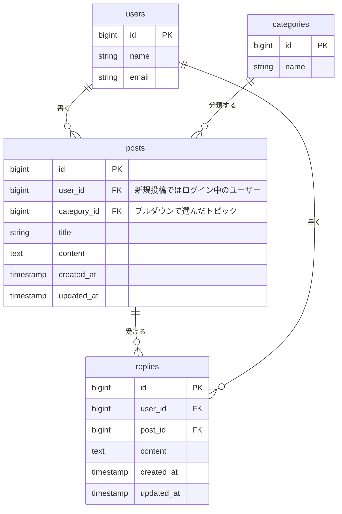

> この設計書は、この機能を実装した時点の記録です。このあとは更新していません。

# ポスト新規投稿機能 設計

Issue: [#3 ポストの新規投稿機能を追加する](https://github.com/futoshi-koda/post-app-practice/issues/3)

## 概要

今のアプリは、既存のポストを読む・編集する・削除する・リプライするはできるが、新しいポストを書く手段がない(seeder のデータのみ)。ログインしたユーザーが自分のつぶやきを投稿し、タイムラインに出せるようにする。

- ポストを書く画面は、編集画面(`posts.edit`)の画面を新規投稿と兼用して使う(新しい画面ファイルは作らない)。タイムラインに、そこへの入口(「ポストする」ボタン)を置く
- ポストの項目は **タイトル・トピック・本文** の3つ
  - 「トピック」は既存の `category_id`(お知らせ・技術メモ・雑記の3件から選ぶ)
  - 「本文」は既存の `content` 列
- 書けるのはログインしているユーザーのみ(`auth` ミドルウェア)
- 投稿者は常にログイン中の本人。他人の名前では投稿できない(`user_id` はフォームから受け取らず、サーバー側でログイン中のユーザーの ID を入れる)
- 新しいテーブル・列は作らない

決めたこと:

| 項目 | 決定 |
|:-----|:-----|
| 入口の形 | 作成画面 `posts.create`(`/posts/create`)。画面の部品は編集画面と兼用する。タイムラインに「ポストする」ボタンを置く |
| 「ポストする」ボタンの位置 | タイムラインの固定ヘッダー内(スクロールしても常に画面上部に出る)。詳細は「増える画面」 |
| 送信ボタン | 新規投稿も編集と同じ「更新」ボタン。新規投稿では、押すと投稿が完了する |
| 送信後の移動先 | タイムライン(`posts.index`)。一覧は新しい順なので、先頭に出る |
| トピック | `category_id`。プルダウンから選ぶ必須項目。先頭に「選択してください」(値は空)を置き、選ばずに送るとエラーにする |
| タイトル | 必須・255字以内(編集画面と同じ) |
| 本文 | 必須・140字以内。改行は `\r\n` を `\n` に揃えてから数える(`ValidatesContent` を再利用) |
| 認可 | `auth` ミドルウェア内にルートを置く。ログインしていれば誰でも書けるので、`PostPolicy` は変更しない |
| 投稿者 | ログイン中のユーザー。フォームに `user_id` が混ざっていても無視する |

## 受け入れ条件

- ログインした状態でタイムラインを開くと、ポストを書く画面への入口(「ポストする」ボタン)がある
- 「ポストする」ボタンは、タイムラインをスクロールしても常に画面上部に表示されている
- タイトル・トピック・本文を入れて「更新」ボタンを押すと、タイムラインの先頭にそのポストが増える
- 本文が空のまま送ると、エラーが表示されてポストは増えない
- 増えたポストには自分の名前が出ていて、編集と削除の操作が出る
- ログアウトすると、ポストを書く画面にたどり着けない(ログイン画面に飛ばされる)

## 変えないもの

- `posts` テーブルの列(確認方法: マイグレーションファイルが増えていないこと)
- タイムライン(`posts.index`)の一覧・編集・削除の動きは変えない
  - 一覧の並び(新しい順)、編集・削除ボタンが出る条件(`PostPolicy`)、編集・削除のあとにタイムラインへ戻る動きは、そのまま
  - 例外はひとつだけ。作成画面へ行くための「ポストする」ボタンを固定ヘッダーに足す(ポストの表示そのものは変えない)
- 編集画面の見た目・動き(兼用にするため部品を共通化するが、編集のときの表示・ボタン名・送信先・エラー表示は今のまま)
- 既に追加したリプライ機能(詳細画面・リプライの送信と削除・`ReplyPolicy`)
- 本文の文字数制限(必須・140字以内、改行の数え方、エラーメッセージ)。ポストの編集・リプライと同じ `ValidatesContent` のまま
- `PostPolicy` と、タイトル・トピックの編集時の入力チェック
- 認証まわり(ログイン・新規登録・ログアウト)

## 増えるテーブル

**増えるテーブルはない。** ポストは既存の `posts` テーブルに1行追加するだけで、列も変えない。マイグレーションファイルは追加しない。

使う列(すべて既存):

| 列 | 入る値 |
|:---|:-------|
| user_id | ログイン中のユーザーの ID(サーバー側で設定。フォームの値は使わない) |
| category_id | 選んだトピック |
| title | 入力したタイトル |
| content | 入力した本文 |
| created_at / updated_at | 保存時に自動で入る。タイムラインの並び(新しい順)に使う |

関係は次のとおり(すべて既存で、変更なし)。



図には関係がわかる列だけを載せている。この機能で追加・変更されるのは行(データ)だけで、構造は変わらない。

## 増える画面

| 画面 | 場所(URL の案) | 内容 |
|:-----|:----------------|:-----|
| ポスト作成画面 | `GET /posts/create` | 編集画面と同じ部品(タイトル(1行入力)・トピック(プルダウン)・本文(複数行入力+残り字数の表示)と、「更新」「キャンセル」ボタン)を、空の状態で表示する |

操作(画面は増えないが、ルートが増える):

| 操作 | ルートの案 | 結果 |
|:-----|:-----------|:-----|
| ポストを送る | `POST /posts` | 「更新」ボタンで送る。入力が正しければ保存してタイムラインへ移る(これで投稿完了)。誤りがあれば作成画面に戻ってエラーを表示する |

既存画面の変更:

| 画面 | 変更 |
|:-----|:-----|
| タイムライン(`posts.index`) | 固定ヘッダーに「ポストする」ボタンを1つ足す(下の「「ポストする」ボタンのレイアウト」を参照)。この画面はログイン中の人にしか開けないので、出し分けは不要 |

「ポストする」ボタンのレイアウト(タイムライン):

```text
┌────────────────────────────────────────┐ ← 固定ヘッダー(`.chrome`)
│ [つ] つぶやき投稿アプリ   名前(メール) [ログアウト] │ ← 1段目(今のまま)
│ ホーム                      [ポストする] │ ← 2段目: 左に見出し、右にボタンを足す
├────────────────────────────────────────┤
│ (ここから下がスクロールする一覧)           │
│  ポスト、ポスト、ポスト …                  │
```

- ボタンは、既存の固定ヘッダー(`position: sticky; top: 0`、`resources/views/posts/_styles.blade.php` の `.chrome`)の中に置く。ヘッダーごと常に画面上部に出るので、新しい仕組み(JavaScript など)は要らない
- 位置は2段目(見出し「ホーム」の行)の右端。見出し行を左右に分ける(`display: flex; justify-content: space-between; align-items: center`)
- 見た目は編集画面の「更新」ボタンと同じ、黒背景・白文字の丸いボタン(`.btn-primary` 相当)。ただしヘッダー内に収まるよう、ログアウトボタンと同じくらいの小さめの大きさにする
- 押すと `GET /posts/create` へ移る(リンク。フォーム送信ではない)
- スマホ幅でも、見出しとボタンは折り返さず1行に収める

作成画面の表示ルール(編集画面との兼用):

- 編集画面(`resources/views/posts/edit.blade.php`)の画面を、新規投稿と編集で兼用する。ヘッダー、入力欄の並び、本文の残り字数カウンタ、エラー表示の位置は共通。違いは次の4点だけ
  - 見出し: 新規は「ポストを書く」、編集は「ポストを編集」(今のまま)
  - 入力欄: 新規は空で始まる。編集は今のポストの内容が入っている(今のまま)
  - トピック: 新規だけ「選択してください」(値は空)を先頭に置く。編集は置かない(今のまま)
  - 送信先: 新規は `POST /posts`、編集は `PUT /posts/{post}`(今のまま)
- 送信ボタンは、新規も編集も「更新」。**新規投稿では、「更新」ボタンを押すと投稿が完了する**(ポストが1件増えて、タイムラインへ移る)
  - ボタン名が「更新」だと新規投稿では意味が合わないが、ボタンを共通にする方針を優先する。名前を分けたくなったら、見出しと同様に新規だけ「投稿」にする
- ヘッダーに、ログイン中のユーザー名・ログアウトボタンは出さない(編集画面と同じ)
- キャンセルはタイムラインへ戻る
- エラーで作成画面に戻ったときは、入力したタイトル・トピック・本文を残す(`old()`)
- ルートの定義順: `GET /posts/create` は `GET /posts/{post}` より**前**に置く(後ろだと `create` がポストの ID と解釈されて 404 になる)
- 未ログインで開こうとすると、ログイン画面へ移る(既存の `auth` ミドルウェアの動き)

## 入力チェックとメッセージ一覧

入力チェック:

| 画面 | 項目 | 必須 | 文字数 | 形式・値の範囲 | ほかの項目との関係 |
|:-----|:-----|:-----|:-------|:---------------|:-------------------|
| ポスト作成画面 | タイトル | 必須 | 255字以内 | 文字列 | - |
| ポスト作成画面 | トピック | 必須 | - | `categories` に存在する ID | - |
| ポスト作成画面 | 本文 | 必須 | 140字以内 | 文字列。改行は `\r\n` を `\n` に揃えてから数える(1改行を1字とする) | - |

- 空白だけの入力は、Laravel 標準の `TrimStrings` ミドルウェアで空文字になるため、「空」として扱う
- 入力チェックは、ポストの編集(`PostController::update`)と同じ内容にする。本文は `ValidatesContent::validateContent` をそのまま使う
- `user_id` は入力チェックの対象にしない。リクエストに含まれていても、保存には使わない

メッセージ一覧:

| 画面 | 出る場面 | 区分 | メッセージ |
|:-----|:---------|:-----|:-----------|
| ポスト作成画面 | 本文が空のまま送信した | エラー | 本文を入力してください。 |
| ポスト作成画面 | 本文が141字以上で送信した | エラー | 本文は140字以内で入力してください。 |
| ポスト作成画面 | タイトルが空のまま送信した | エラー | The title field is required.(Laravel 標準の英語。編集画面と同じ) |
| ポスト作成画面 | タイトルが256字以上で送信した | エラー | The title must not be greater than 255 characters.(同上) |
| ポスト作成画面 | トピックを選ばずに送信した | エラー | The category id field is required.(同上) |
| ポスト作成画面 | 存在しないトピックの ID を送信した | エラー | The selected category id is invalid.(同上。画面からは起こらず、リクエストを書き換えたときだけ) |
| (共通) | 未ログインで作成画面を開く・送信した | 移動 | ログイン画面へ移る(エラー表示はなし) |

- 本文の2つのエラーは、ポストの編集・リプライと同じ文言(`ValidatesContent` で共通)
- タイトル・トピックのエラーは、今は編集画面でも日本語化されておらず(`config/app.php` の `locale` が `en`、`lang/` なし)、Laravel 標準の英語が出る。この Issue では日本語化せず、編集画面に揃える(日本語化するなら別 Issue で、編集画面と同時に行う)
- ポストを送ったときの完了メッセージは出さない(ポストの編集・削除も出していないため、それに揃える)

## テスト観点

Feature テストで確認する(`PostContentLimitTest` と同じく `RefreshDatabase` を使う)。テストデータとして、カテゴリを作る方法(`CategoryFactory` か seeder の利用)を決めておく。

表示:

- ログインしていると、タイムラインに「ポストする」ボタンが出て、作成画面(`posts.create`)へのリンクになっている
- 「ポストする」ボタンが、スクロールしても残る固定ヘッダーの中にある(自動テストでは、ヘッダー要素の中にボタンのリンクがあることを確認する。常に上部に出ることは、ブラウザで長い一覧をスクロールして目で確認する)
- ログインしていると、作成画面が開け、入力欄が空で、トピックの選択肢(お知らせ・技術メモ・雑記)と「選択してください」と、「更新」ボタンが出る
- 編集画面は今までどおり(今のポストの内容が入っている、トピックに「選択してください」が出ない、見出しが「ポストを編集」、`PUT` で更新できる)
- タイムラインの既存の動き(新しい順、編集・削除ボタンの出方、本文・日時の詳細画面へのリンク)が変わっていない

送信(正常):

- タイトル・トピック・本文を入れて送る(「更新」ボタン相当の `POST /posts`)と、`posts` に1件増え、タイムラインへ移る
- 保存されたポストの `user_id` が、ログイン中のユーザーの ID になっている
- 送ったポストがタイムラインの先頭に出る(既存のポストより上)
- 140字ちょうどの本文は通る
- 改行を含む本文が `\r\n` でも、1改行を1字として数える(改行を含めて140字で通り、141字でエラー)

送信(エラー):

- 本文が空だと、「本文を入力してください。」が出て、ポストは増えない
- 空白だけの本文も、同じくエラーになる
- 141字の本文は、「本文は140字以内で入力してください。」が出て、ポストは増えない
- タイトルが空だとエラーになり、ポストは増えない。256字もエラーになり、255字は通る
- トピックを選ばない(空)とエラーになり、ポストは増えない
- 存在しない `category_id` を送るとエラーになり、ポストは増えない
- エラーのとき、入力したタイトル・トピック・本文が残る

投稿者:

- リクエストに他人の `user_id` を混ぜて送っても、ログイン中のユーザーのポストとして保存される(他人の名前では投稿できない)
- 投稿したポストは、投稿した本人には編集・削除が出て、別のユーザーでタイムラインを開くと出ない
- 投稿したポストに、リプライを付けられる(既存のリプライ機能が壊れていない)

ログイン:

- ログインしていないと、作成画面の表示も送信もできない(ログイン画面へ移る)。未ログインで送っても、ポストは増えない
- `GET /posts/create` が `posts.show` に取られず、404 にならない(ルートの定義順の確認)

構造:

- 新しいマイグレーションファイルが増えていない(レビューで `git diff --stat main -- database/migrations` が空であることを確認する)
