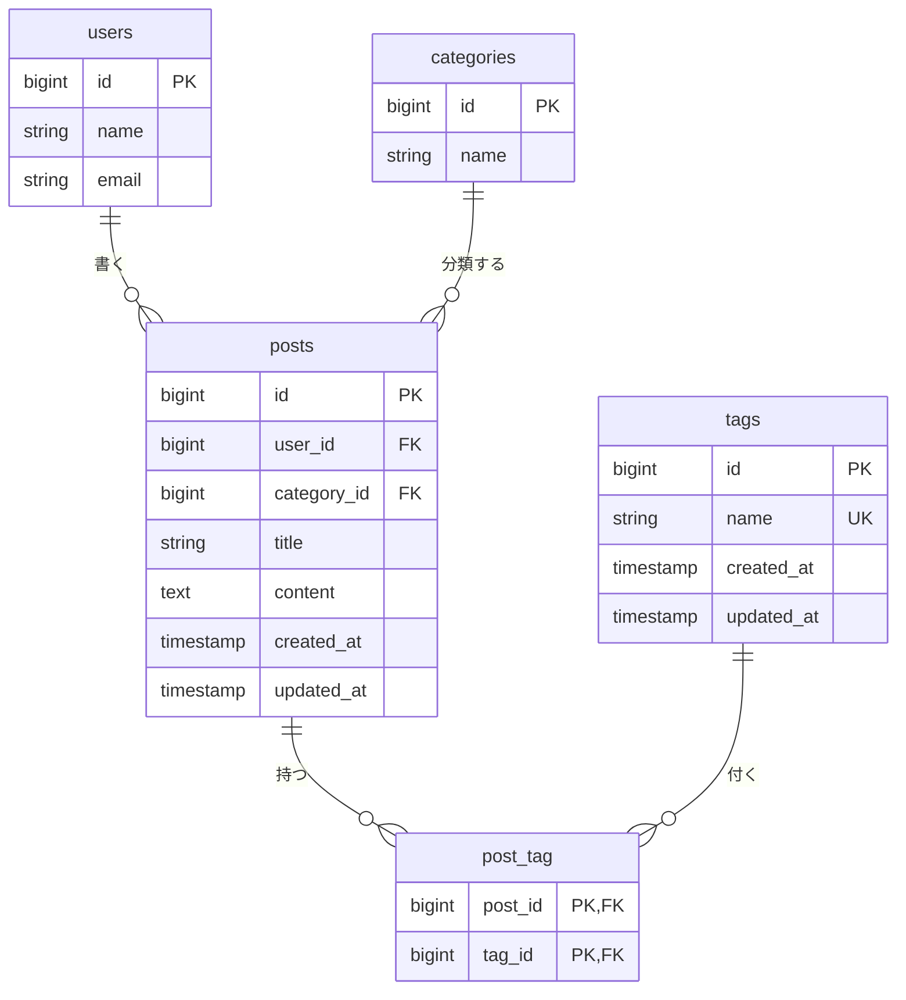

# ポストのタグ 設計

Issue: [#11 ポストにタグを付けて、タイムラインをタグで絞り込めるようにする](https://github.com/futoshi-koda/post-app-practice/issues/11)

## 概要

タイムラインは新しい順に全ポストが並ぶだけで、ポストが増えると読みたいものを探せない。ポストに**タグ(ハッシュタグ)**を付けられるようにし、タイムラインをタグで絞り込めるようにする。

- タグは**あらかじめ用意されたものから選ぶ**。タグを新しく作る・名前を変える・消す画面は作らない(管理画面もなし)
- 1 つのポストに付けられるタグは **0 個以上(複数可)**。タグなしのポストもある
- タグを付け替えられるのは**そのポストを書いた本人だけ**(ポストの編集と同じ権限。`PostPolicy::update` に乗る)
- タグは**トピック(お知らせ・技術メモ・雑記)とは別物**。トピックは「ポストの種類(必須・1 つ)」、タグは「ポストの性格(任意・複数)」。トピックの仕組みには手を入れない

決めたこと:

| 項目 | 決定 |
|:-----|:-----|
| タグの名前(5 件) | `学び` / `つまずき` / `質問` / `発見` / `おすすめ`。画面では `#学び` のように `#` を付けて表示し、DB には `#` なしで保存する |
| 用意のしかた | `DatabaseSeeder` で 5 件入れる(トピックと同じ方式) |
| 保存先 | 新テーブル `tags` と中間テーブル `post_tag`。`posts` テーブルに列は足さない |
| モデル | `Tag` を新設。`Post::tags()` / `Tag::posts()` は多対多 |
| 選ぶ画面 | 作成・編集画面(`posts/edit.blade.php` 兼用)にチェックボックス。複数選択・未選択も可。編集画面では今付いているタグにチェックを入れておく |
| 保存 | `store` / `update` で `sync` する。入力は `tag_ids[]` |
| 認可 | 既存の `PostPolicy::update` に乗る。`edit` / `update` は他人のポストなら 403(追加の Policy は不要) |
| 「編集済み」との関係 | タグだけを付け替えても `posts.updated_at` は動かさない(=「編集済み」にならない)。タイトル・本文・トピックを変えたときは今までどおり |
| 絞り込みの URL | `GET /posts?tag={tag の id}`(同じ `posts.index`。新しいルートは作らない)。タグは**1 つだけ**選べる |
| 絞り込みの入口 | ① タイムライン上部に「すべて」+ 5 タグのリンク一覧(いま選んでいるものは見た目で分かるようにする) ② 各ポストに出ているタグをクリックしても同じ絞り込みになる |
| 絞り込み結果 | 並びは今までどおり新しい順。該当ポストが 0 件のときは「該当するポストがありません。」を出す(既存の「まだポストがありません。」とは文言を分ける) |
| 存在しないタグの指定 | `?tag=` に存在しない ID が来たら 404 |
| seeder のポスト | 24 件のうち半分程度にタグを付け、タグなしのポストも残す。5 タグすべてが 1 件以上のポストに付くようにする |

## 受け入れ条件

- ポストの作成画面と編集画面で、あらかじめ用意されたタグから選んで保存できる
- タイムラインのポストそれぞれに、そのポストに付いているタグが出る(1 つも付いていないポストには何も出ない)
- タイムラインでタグを 1 つ選ぶと、そのタグが付いたポストだけが並ぶ
- 他人のポストの編集画面を URL で直接開くと 403 になり、他人のポストのタグは変えられない

## 変えないもの

- タイムライン(`posts.index`)の一覧・編集・削除の動きは変えない
  - 変えるのは「各ポストにタグを出す」「絞り込みの入口を足す」ことだけ
  - 絞り込まないとき(`?tag` なし)の並び(新しい順)、編集・削除ボタンが出る条件(`PostPolicy`)、編集・削除のあとにタイムラインへ戻る動きは、そのまま
  - 編集・削除ボタンは既存テストが `value="DELETE"` の有無で見分けているので、タグまわりの部品にこの文字列を含めない
- トピック(`category`)の選択・表示・入力チェック
- いいね・リプライ・「編集済み」の目印の動き
- 詳細画面(`posts.show`)へのタグ表示(今回はタイムラインのみ)
- タグの新規作成・名前変更・削除の画面(作らない)
- `PostPolicy` と、`posts` テーブルの列、既存の入力チェック(タイトル 255 字・本文 140 字・トピック)
- 認証まわり(ログイン・新規登録・ログアウト)

## 増えるテーブル

`tags` と `post_tag` の 2 つを追加する。`post_tag` は `posts` と `tags` をつなぐ中間テーブルで、ポストが消えてもタグが消えても、つながりだけが一緒に消える(ポストやタグ本体は巻き込まない)。

`users` / `categories` / `posts` は既存のテーブルで、図には関係がわかる列だけを載せている。

`tags` の列:

| 列 | 型 | 制約 | 説明 |
|:---|:---|:-----|:-----|
| id | bigint | 主キー | タイムラインの絞り込み URL(`?tag={id}`)と、チェックボックスの値に使う |
| name | string | NOT NULL、一意 | タグの名前。`#` は付けずに保存する(例: `学び`) |
| created_at / updated_at | timestamp | | |

`post_tag` の列:

| 列 | 型 | 制約 | 説明 |
|:---|:---|:-----|:-----|
| post_id | bigint | 外部キー(`posts.id`)、親の削除で連動して削除 | どのポストか |
| tag_id | bigint | 外部キー(`tags.id`)、親の削除で連動して削除 | どのタグか |

- `post_id` + `tag_id` の組み合わせで一意にする(同じタグを同じポストに 2 回付けられない)
- 中間テーブルに `id` と `created_at` / `updated_at` は持たせない(付け外ししか使わないため)。付け外しで `posts.updated_at` が動かないのも、これと `sync` の組み合わせによる
- 並びは `tags.id` の昇順(= seeder で入れた順)で、タグの一覧にも選択肢にも使う

モデルの関係:

| 関係 | 内容 |
|:-----|:-----|
| `Post::tags()` | `belongsToMany(Tag::class)` |
| `Tag::posts()` | `belongsToMany(Post::class)` |

## 増える画面

新しい画面とルートは増えない。既存の 2 つの画面に部品を足す。

| 画面 | 場所 | 足すもの |
|:-----|:-----|:---------|
| 作成画面・編集画面 | `GET /posts/create`、`GET /posts/{post}/edit`(`posts/edit.blade.php` 兼用) | 「タグ」のチェックボックス(5 件を `#名前` で表示)。複数選択・未選択も可。編集画面では今付いているタグにチェックを入れる。入力エラーで戻ったときは、選んでいたタグのチェックを残す(`old('tag_ids')`) |
| タイムライン | `GET /posts`(`posts/index.blade.php`) | ① 上部に「すべて」+ 5 タグのリンク一覧 ② 各ポストに付いているタグ(`#名前`、クリックで絞り込み) |

絞り込み(`GET /posts?tag={tag の id}`):

| 操作 | URL | 結果 |
|:-----|:----|:-----|
| 「すべて」を選ぶ | `/posts` | 全ポストが新しい順に並ぶ(今までどおり) |
| タグを 1 つ選ぶ | `/posts?tag={id}` | そのタグが付いたポストだけが新しい順に並ぶ |
| 存在しないタグを指定する | `/posts?tag=9999` など | 404 |

タイムラインの表示ルール:

- 上部の一覧は「すべて」+ 5 タグ(`tags.id` 昇順)。いま選んでいるもの(絞り込んでいないときは「すべて」)は、見た目で分かるようにする
- 各ポストのタグは、付いているものだけを `#名前` で出す。1 つも付いていないポストにはタグの欄を出さない
- タグを絞り込んだあとも、各ポストには**そのポストに付いているタグすべて**を出す(絞り込んだタグだけにしない)
- 絞り込み結果が 0 件のときは「該当するポストがありません。」を出す。ポストがそもそも 1 件もないときの「まだポストがありません。」とは出し分ける
- 絞り込み中も、編集・削除・いいね・リプライへのリンクの動きは変えない
- 実装の注意: タイムラインはタグを `with(['user', 'category', 'tags'])` でまとめて読み込み、ポストごとに SQL が増えないようにする

## 入力チェックとメッセージ一覧

入力チェック:

| 画面 | 項目 | 必須 | 文字数 | 形式・値の範囲 | ほかの項目との関係 |
|:-----|:-----|:-----|:-------|:---------------|:-------------------|
| 作成画面・編集画面 | タグ(`tag_ids[]`) | 任意(0 個でもよい) | - | 配列。各要素は `tags.id` に存在する値(`exists:tags,id`)。複数可 | トピック・タイトル・本文とは独立 |
| タイムライン | 絞り込み(`?tag`) | 任意 | - | 存在する `tags.id` | 存在しない値は 404 |

- 入力チェックは `PostController::validatePost` の `$rules` と `$messages` に足す(`validateContent` の第 2・第 3 引数)。`lang/ja` は使わず、ルールごとに日本語を個別に指定する
- `tag_ids` が送られないとき(チェックを全部外したとき)は、**タグを 0 個にする**(`sync([])`)。`validated` に `tag_ids` が無くても落ちないようにする
- `validated` から `tag_ids` を除いてから `Post` を作る・更新する(`posts` に `tag_ids` 列は無い)。タグの保存はそのあとに `sync` で行う
- タグだけを付け替えたときは `posts.updated_at` を動かさない(「編集済み」にしない)

メッセージ一覧:

| 画面 | 出る場面 | 区分 | メッセージ |
|:-----|:---------|:-----|:-----------|
| 作成画面・編集画面 | 存在しないタグの ID を送った(`tag_ids.*`) | エラー | 選択したタグは存在しません。 |
| 作成画面・編集画面 | `tag_ids` が配列でない形で送られた(`tag_ids`) | エラー | タグの選択が正しくありません。 |
| タイムライン | 絞り込んだ結果が 0 件 | 案内 | 該当するポストがありません。 |
| タイムライン | ポストが 1 件もない(既存) | 案内 | まだポストがありません。 |
| (共通) | 他人のポストの編集画面を開く・更新する | エラー | 403(Laravel 標準の「権限がありません」画面) |
| (共通) | 存在しないタグで絞り込んだ | エラー | 404(Laravel 標準の画面) |

- チェックボックスで選ぶ作りなので、通常の操作で「存在しないタグ」は送れない。URL やフォームを書き換えた場合の備えとして用意する
- 2 行目(`tag_ids` が配列でない)のメッセージは、Issue に文言の指定がないので、この設計書で決めた案。変えたいときはここと `validatePost` の `$messages` を直す
- タグを付け替えた・絞り込んだときの完了メッセージは出さない(ポストの編集・削除も出していないため、それに揃える)

## テスト観点

Feature テストで確認する(`tests/Feature/PostTagTest.php` を新設。既存テストと同じく `RefreshDatabase` を使い、URL は `route()` で書く)。`Tag` のファクトリは作らず、テストでは `Tag::create` で用意してもよい(必要ならファクトリを足す)。

作成・保存:

- 作成画面にタグのチェックボックスが出る(5 件を `#名前` で表示)
- タグを複数選んで保存すると、そのポストにタグが付く
- タグを 1 つも選ばずに保存すると、タグなしのポストができる(今までどおり作れる)

編集・付け替え:

- 編集画面で、今付いているタグにチェックが入っている
- タグを付け替えて保存できる(外す・足す。全部外して 0 個にもできる)
- タグだけを付け替えても「編集済み」にならない(`updated_at` が変わらない)。タイトルや本文を変えたときは今までどおり「編集済み」になる

入力チェック:

- 存在しないタグ ID を送ると、日本語のメッセージで弾かれ、DB は変わらない(`assertSessionHasErrors(['tag_ids.0' => '選択したタグは存在しません。'])`)
- `tag_ids` を配列でない形で送ると、日本語のメッセージで弾かれる(`assertSessionHasErrors(['tag_ids' => 'タグの選択が正しくありません。'])`)
- エラーで戻ったとき、選んでいたタグのチェックが残る

認可:

- 他人のポストの編集画面(`GET`)が 403
- 他人のポストを `PUT` でタグを変えようとしても 403 で、DB は変わらない

タイムラインの表示:

- 各ポストに付いているタグが `#名前` で出る
- タグなしのポストにはタグが出ない
- 付けていないタグは、そのポストに出ない

絞り込み:

- `?tag={id}` で絞ると、そのタグのポストだけが出て、付いていないポストは出ない
- 絞り込んだあとも、各ポストに付いているタグ全部が出る
- 絞り込んでも、並びは新しい順
- 該当が 0 件のときは「該当するポストがありません。」が出て、「まだポストがありません。」は出ない
- ポストが 1 件もないときは、今までどおり「まだポストがありません。」が出る
- 存在しない ID は 404
- 上部の一覧に「すべて」と 5 タグが出て、選んでいるものが分かる

連動:

- ポストを消すと、`post_tag` のそのポストの行も消える(タグ本体は残る)
- タグを消すと、`post_tag` のそのタグの行も消える(ポスト本体は残る)
- 同じタグを同じポストに 2 回付けられない(組み合わせの一意)

seeder:

- `DatabaseSeeder` で、タグ 5 件が入る
- ポストの半分程度にタグが付き、タグなしのポストも残る。5 タグすべてが 1 件以上のポストに付く

回帰(今までどおり):

- タグなしで、ポストの作成・編集・削除が今までどおりできる
- タイムラインの一覧(新しい順)・編集・削除ボタンの出方が変わっていない
- いいね・リプライ・「編集済み」の目印が今までどおり動く
- トピックの選択・表示・入力チェックが変わっていない
