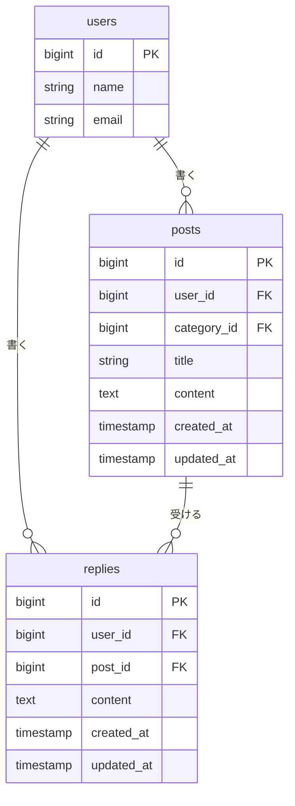

# リプライ機能 設計

Issue: [#1 ポストにリプライ機能を追加する](https://github.com/futoshi-koda/post-app-practice/issues/1)

## 概要

今のアプリはポストを読むだけで、返す手段がない。ポストを読んだ人がその場で一言返せるよう、リプライ機能を追加する。

- ポストを1件開く画面(ポスト詳細画面)を新しく作り、そこにそのポストとリプライの一覧、リプライの入力欄を置く
- リプライはポストに対するフラットな返信とし、リプライへのリプライは作らない
- リプライを消せる人の判定は `app/Policies/PostPolicy.php` のやり方に揃える(`user_id` が自分と一致するときだけ)
- ログインが必要なのは既存のポスト関連の画面と同じ(`auth` ミドルウェア)

決めたこと:

| 項目 | 決定 |
|:-----|:-----|
| 詳細画面への導線 | タイムラインの本文・日時をリンクにする |
| 本文の文字数 | 必須・140字以内(ポストと同じ) |
| リプライ一覧の並び順 | 古い順(会話の流れ) |
| 送信・削除したあとの移動先 | 同じポストの詳細画面 |
| 親ポストが削除されたとき | リプライも一緒に削除する |
| リプライへのリプライ | 対象外 |
| 削除できる人 | リプライを直接消せるのは、そのリプライを書いた本人だけ(ポストの作者でも他人のリプライは消せない)。親ポストが消えたときの連動削除は、この権限とは別で、ポスト作者の操作の結果として起きる(`ReplyPolicy` は通らない) |

## 受け入れ条件

- ポストを1件開くと、そのポストとリプライの一覧が見える
- 本文を入れてリプライを送ると、一覧に増える
- 本文が空のままだと、エラーが表示されてリプライは増えない
- 自分のリプライは消せて、他人のリプライは消せない

## 変えないもの

- タイムライン(`posts.index`)の一覧・編集・削除の動きは変えない
  - 一覧の並び(新しい順)、編集・削除ボタンが出る条件(`PostPolicy`)、編集・削除のあとにタイムラインへ戻る動きは、そのまま
  - 例外はひとつだけ。詳細画面へ行くために、ポストの本文・日時をリンクにする(見た目の変更はこれだけ)
- `PostPolicy` と、ポストの `posts` テーブル、ポストの入力チェック(タイトル255字・本文140字・カテゴリ)は変更しない
- 認証まわり(ログイン・新規登録・ログアウト)は変更しない

## 増えるテーブル

`replies` テーブルを1つ追加する。`posts` と同じく、ユーザーが消えたら一緒に消え、ポストが消えたら一緒に消える。

`users` と `posts` は既存のテーブルで、図には関係がわかる列だけを載せている。

`replies` の列:

| 列 | 型 | 制約 | 説明 |
|:---|:---|:-----|:-----|
| id | bigint | 主キー | |
| user_id | bigint | 外部キー(`users.id`)、親の削除で連動して削除 | リプライを書いた人。削除できる人の判定に使う |
| post_id | bigint | 外部キー(`posts.id`)、親の削除で連動して削除 | どのポストへのリプライか |
| content | text | NOT NULL | リプライの本文(140字以内) |
| created_at / updated_at | timestamp | | 一覧の並び(`created_at` の古い順)に使う |

リプライに `title` と `category_id` は持たせない(一言返すための機能なので、本文だけにする)。

## 増える画面

| 画面 | 場所(URL の案) | 内容 |
|:-----|:----------------|:-----|
| ポスト詳細画面 | `GET /posts/{post}` | 上にポスト(投稿者・日時・カテゴリ・タイトル・本文)、その下にリプライ一覧(古い順)、いちばん下にリプライの入力欄 |

操作(画面は増えないが、ルートが増える):

| 操作 | ルートの案 | 結果 |
|:-----|:-----------|:-----|
| リプライを送る | `POST /posts/{post}/replies` | 入力が正しければ保存して詳細画面へ戻る。誤りがあれば詳細画面に戻ってエラーを表示する |
| リプライを消す | `DELETE /replies/{reply}` | 本人なら削除して詳細画面へ戻る。本人でなければ 403 |

詳細画面の表示ルール:

- リプライ一覧は `created_at` の古い順。1件もないときは「まだリプライがありません。」と表示する
- 各リプライには投稿者名・日時・本文を出す。削除ボタンは、自分が書いたリプライにだけ出す(`@can('delete', $reply)`)
- 入力欄は、エラーで詳細画面に戻ったときに入力した本文を残す(`old('content')`)
- 詳細画面の入口は、タイムラインのポストの本文・日時のリンク
- 詳細画面からタイムラインへ戻るリンクは、ヘッダーのアプリ名(既存の `posts.index` へのリンク)を使う
- 存在しないポストの URL を開いたときは 404

## 入力チェックとメッセージ一覧

入力チェック:

| 画面 | 項目 | 必須 | 文字数 | 形式・値の範囲 | ほかの項目との関係 |
|:-----|:-----|:-----|:-------|:---------------|:-------------------|
| ポスト詳細画面 | リプライの本文 | 必須 | 140字以内 | 文字列。改行は `\r\n` を `\n` に揃えてから数える(1改行を1字とする) | - |

- 空白だけの本文は、Laravel 標準の `TrimStrings` ミドルウェアで空文字になるため、「空」として扱う
- 文字数の数え方・改行の扱いは、ポストの本文(`PostController::update`)に揃える

メッセージ一覧:

| 画面 | 出る場面 | 区分 | メッセージ |
|:-----|:---------|:-----|:-----------|
| ポスト詳細画面 | 本文が空のまま送信した | エラー | 本文を入力してください。 |
| ポスト詳細画面 | 本文が141字以上で送信した | エラー | 本文は140字以内で入力してください。 |
| ポスト詳細画面 | リプライが1件もない | 案内 | まだリプライがありません。 |
| (共通) | 他人のリプライを消そうとした | エラー | 403(Laravel 標準の「権限がありません」画面) |
| (共通) | 存在しないポストを開いた | エラー | 404(Laravel 標準の画面) |

- 上2つのエラーは `PostController::update` の本文のメッセージと同じ文言にする
- リプライを送った・消したときの完了メッセージは出さない(ポストの編集・削除も出していないため、それに揃える)

## テスト観点

Feature テストで確認する(`PostContentLimitTest` と同じく `RefreshDatabase` を使う)。

表示:

- ポスト詳細画面に、そのポストの内容とリプライが古い順で出る
- 別のポストのリプライは出ない
- リプライがないときは「まだリプライがありません。」が出る
- 自分のリプライには削除ボタンが出て、他人のリプライには出ない
- タイムラインの本文・日時が詳細画面へのリンクになっている
- タイムラインの既存の動き(新しい順、編集・削除ボタンの出方)が変わっていない

送信:

- 本文を入れて送ると、`replies` に1件増え、詳細画面へ戻る
- 本文が空だと、エラーメッセージが出て、リプライは増えない
- 空白だけの本文も、同じくエラーになる
- 140字ちょうどは通り、141字はエラーになる
- 改行を含む本文が `\r\n` でも、1改行を1字として数える(改行を含めて140字で通り、141字でエラー)
- エラーのとき、入力した本文が入力欄に残る
- 存在しないポストへは送れない(404)

削除:

- 自分のリプライは消せて、詳細画面へ戻る
- 他人のリプライは消せない(403)、リプライは残る
- ポストの作者でも、他人のリプライは消せない(403)

ログイン・連動:

- ログインしていないと、詳細画面の表示・送信・削除はできない(ログイン画面へ移る)
- 親のポストを消すと、そのリプライも消える
- ユーザーを消すと、そのユーザーのリプライも消える(外部キーの連動)
